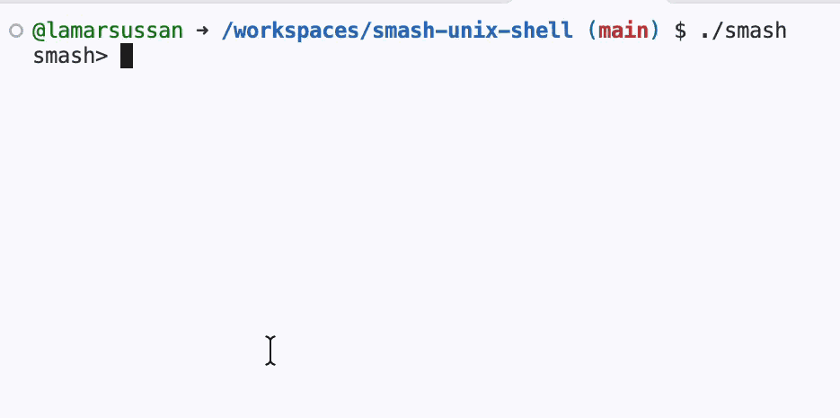

<div align="center">

# 🖥️ Smash — Unix-like Shell

### A C++ Shell Built with Linux/POSIX System Calls


</div>

---

## 🚀 Overview

Smash is a Unix-like command-line shell developed in C++ using Linux/POSIX system calls.

The project focuses on low-level systems programming, process management, job control, signal handling, and command execution.


## 🎬 Live Demo

See Smash in action! The demo showcases command execution, process management, pipes, and background job control.





## ✨ Key Features

### ⚙️ Process Management
- Execute external commands
- Manage foreground and background processes
- Handle process creation and termination

### 🔄 Job Control
- Track and manage running jobs
- Support foreground and background execution
- Handle process groups and job-related operations

### 📡 Signal Handling
- Handle keyboard-generated signals
- Manage process interruption and control
- Integrate signal handling with shell execution

### 🔀 Pipes & I/O Redirection
- Support command pipelines
- Redirect command input and output
- Work with Linux file descriptors

---

## 🛠️ Technologies

| Technology | Purpose |
|------------|---------|
| C++ | Core implementation |
| Linux | Execution environment |
| POSIX | Process and system-level operations |
| Make | Build automation |

---

## 📂 Project Structure

```text
smash-unix-shell/
├── Commands.cpp
├── Commands.h
├── signals.cpp
├── signals.h
├── smash.cpp
├── Makefile
└── README.md
```

---

## ▶️ Build & Run

### Prerequisites

- Linux environment
- C++ compiler (g++)
- Make

### Build

```bash
make
```

### Run

```bash
./smash
```

### Clean build files

```bash
make clean
```

---

## 🧠 Technical Concepts

- Process creation and execution
- Foreground and background jobs
- POSIX system calls
- Signal handling
- File descriptors
- Pipes and I/O redirection
- Process groups and job control

---

<div align="center">

### 💻 Built with C++ and Linux

*Exploring operating systems through hands-on systems programming.*

</div>
